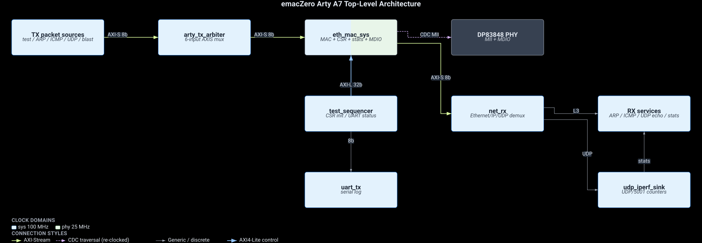
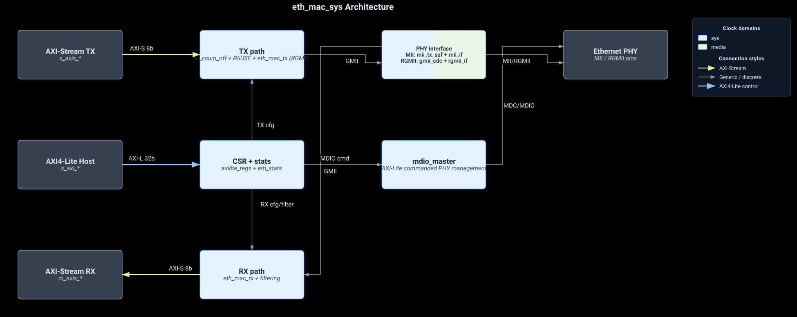

# emacZero

[](https://github.com/lcapossio/emacZero/actions/workflows/sim.yml?query=branch%3Amain)
[](https://github.com/lcapossio/emacZero/actions/workflows/parity.yml?query=branch%3Amain)

Open-source 10/100/1G Ethernet MAC in Verilog 2001, with a VHDL-93 port that
is formally proven equivalent to it ([docs/vhdl_port.md](docs/vhdl_port.md)).
It connects through MII (10/100), GMII (1G, e.g. to a 1000BASE-X / SGMII
PCS) or RGMII (10/100/1G, speed selected at run time), and has AXI4-Stream
data ports and AXI4-Lite control.

## Index

- [Features](#features)
- [Architecture](#architecture)
- [Usage](#usage)
- [Software](#software)
- [Hardware](#hardware)
- [Testing](#testing)
- [Resource Usage](#resource-usage)
- [Security and CRA Readiness](#security-and-cra-readiness)
- [License](#license)
- [Author](#author)

## Features

- **AXI4-Stream TX/RX**: byte-wide, with buffered RX back-pressure.
- **AXI4-Lite registers**: MAC address, TX/RX enable, promiscuous mode, run-time
  speed select, jumbo enable, checksum offload controls
  ([docs/registers.md](docs/registers.md)).
- **PHY interfaces**: MII (10/100, store-and-forward CDC FIFOs), GMII (1G),
  RGMII (10/100/1G, `RGMII_SPEEDS` drops the unused rates).
- **Jumbo frames**: up to 9018 bytes on GMII and RGMII (`MAX_FRAME`).
- **Checksum offload** (optional, per direction): IPv4 header, TCP, UDP, ICMP
  and ICMPv6 over IPv4 and IPv6, inserted on TX, verified on RX.
- **802.3x PAUSE**: send, honour, and automatic PAUSE from the RX FIFO level.
- **CRC-32** FCS generation and checking, minimum-frame padding, 12-byte IFG.
- **MAC address filtering**: unicast, broadcast, optional multicast hash,
  promiscuous.
- **Statistics counters** (32-bit, saturating), **MDIO master** (Clause 22
  and 45), **interrupts** (TX done, RX frame, MDIO done).
- **Vendor-agnostic**: DDR I/O wrappers for Xilinx 7-series and UltraScale+,
  portable async FIFO.
- **Optional L3 helpers** (`rtl/net/`): IPv4/ICMP/UDP parser, ICMP and UDP
  echo, UDP blast generator, iperf2 sink.

The details and limits of each are in
[docs/integration.md](docs/integration.md).

## Architecture

Rendered block diagrams are clock-domain coloured and clickable for the full SVG.

[](docs/architecture.svg)

[](docs/eth_mac_sys_architecture.svg)

The top level is `eth_mac_sys`: registers, statistics, MAC, PHY interface and
MDIO. The source files, ports and clocking rules are in
[docs/integration.md](docs/integration.md).

## Usage

**FuseSoC**: see [emaczero.core](emaczero.core).

| Target | Top | Filesets |
|--------|-----|----------|
| `default` | `eth_mac_sys` | MAC IP only |
| `with_l3` | `eth_mac_sys` | + ICMP echo / IP RX parser |
| `vhdl` | `eth_mac_sys` | MAC IP, VHDL port |
| `arty_a7` | `arty_a7_top` | full demo + XDC |

```bash
fusesoc run --target=default bard0:eth:emaczero
```

**Filelist**: [rtl/eth_mac_sys.f](rtl/eth_mac_sys.f) is the MAC IP and
[rtl/eth_mac_sys_l3.f](rtl/eth_mac_sys_l3.f) adds the L3 helpers. `-I rtl` is
needed for `version.vh`.

```bash
iverilog -g2001 -I rtl -f rtl/eth_mac_sys.f your_top.v
```

For synthesis, define the DDR cell target: `XILINX_7SERIES` or
`XILINX_ULTRASCALE_PLUS`. The `SIM` models are for simulation only.

**VHDL**: [rtl/eth_mac_sys_vhdl.f](rtl/eth_mac_sys_vhdl.f). The first file picks
the vendor target. Entity, generic and port names match the Verilog
([docs/vhdl_port.md](docs/vhdl_port.md)).

**LiteX**: `litex_emaczero/emaczero.py` wraps `eth_mac_sys` as a
`LiteXModule` with LiteX AXI-Lite and AXI-Stream interfaces:

```python
from litex_emaczero import EmacZero, add_sources
add_sources(platform)
self.submodules.mac = mac = EmacZero(platform, platform.request("eth"),
                                     phy_interface="MII")
```

**Main parameters**

| Parameter | Default | Meaning |
|-----------|---------|---------|
| `PHY_INTERFACE` | `"MII"` | `"MII"`, `"GMII"` or `"RGMII"` |
| `CLK_FREQ_HZ` | 100000000 | `clk` frequency; at least 125 MHz for a 1G-capable build |
| `MAX_FRAME` | 1518 | Largest frame in bytes; up to 9018 on GMII / RGMII |
| `RGMII_SPEEDS` | `"ALL"` | `"ALL"`, `"1G_ONLY"` or `"10_100"` |
| `MCAST_HASH_FILTER` | 0 | 1 = 64-bit multicast hash filter |
| `TX_CSUM_OFFLOAD` / `RX_CSUM_OFFLOAD` | 0 | 1 = build the checksum inserter / checker |
| `TXRX_EN_AT_RESET` | 0 | 1 = TX and RX enabled at reset, for designs with no CPU |

With the defaults, CTRL resets to `0x20`, with TX and RX off. Software writes
the MAC address, then sets `tx_en` and `rx_en` (`emz_init` in `sw/emaczero/`
does both). The full register map is in [docs/registers.md](docs/registers.md).

[examples/eth_mac_sys_minimal/](examples/eth_mac_sys_minimal/) is a
copy-paste wrapper that exposes every port with no demo logic.

## Software

- **Bare metal**: C99 driver in [sw/emaczero/](sw/emaczero/), two files, no
  malloc, no OS calls ([sw/README.md](sw/README.md)).
- **Linux**: out-of-tree netdev driver in [sw/linux/](sw/linux/) for Linux
  6.12 or later, over a dmaengine provider, with NAPI, BQL, phylink and the
  MAC counters in `ethtool -S`. Work in progress: on a ZCU106 (AXI DMA,
  1000BASE-X) against a PC it ran TCP at 941 Mb/s received and 933 Mb/s sent
  ([sw/linux/README.md](sw/linux/README.md)).

## Hardware

- **Arty A7-100T**: MII with the on-board DP83848J PHY, an ARP/ICMP/UDP demo
  and iperf tests. At 100 Mb/s full duplex with 1472-byte UDP payloads, a 60 s
  bidirectional test ran 95.68 Mb/s to the PC and 95.78 Mb/s from it,
  with no gaps (2026-09-23).
  See [fpga/arty_a7/README.md](fpga/arty_a7/README.md).
- **ZCU106**: GMII behind the AMD 1G/2.5G PCS/PMA (1000BASE-X on SFP0). Through
  a 1000BASE-T copper SFP to a PC it ran 10 minutes full duplex with no frame
  lost: 957 Mb/s of UDP payload sent (100% of line rate) and 955 Mb/s received.
  See [fpga/zcu106/README.md](fpga/zcu106/README.md).

## Testing

```bash
python build_and_test.py
```

This runs:
- Icarus and Verilator lint;
- the directed Icarus testbenches;
- the cocotb suites on the Verilog and, under GHDL, on the VHDL port.

The Vivado phases (DDR cell models, xsim on the VHDL port) run when Vivado is
on `PATH`. The formal Verilog/VHDL equivalence proofs run separately, in
[sim/parity/](sim/parity/). CI (`sim.yml`, `parity.yml`) runs both on every
push and PR to `main`.

Tools, phases and the bench list: [sim/README.md](sim/README.md). cocotb
suites: [sim/cocotb/README.md](sim/cocotb/README.md).

## Resource Usage

The routed Arty A7-100T reference build: Vivado 2025.2, `xc7a100tcsg324-1`,
`PHY_INTERFACE="MII"`, `MAX_FRAME=1518`, `TX_CSUM_OFFLOAD=0`, full demo logic,
measured 2026-06-14. Timing met at 100 MHz `clk` with WNS 0.349 ns.

| Scope | LUTs | FFs | RAMB36 | RAMB18 | DSP | Notes |
|-------|-----:|----:|-------:|-------:|----:|-------|
| Full `arty_a7_top` | 9,959 | 19,254 | 4 | 1 | 0 | MAC + ARP/ICMP/UDP demo + UART/sequencer |
| `u_mac_sys` hierarchy | 1,858 | 1,801 | 4 | 1 | 0 | CSR, stats, MAC, MII, MDIO, pause |
| `gen_mii.u_mii_if` | 344 | 708 | 3 | 1 | 0 | MII CDC FIFOs |
| `u_mac_rx` | 200 | 212 | 1 | 0 | 0 | RX AXIS FIFO (2048 B) |
| `u_mac_tx` | 229 | 111 | 0 | 0 | 0 | TX preamble/FCS/IFG path |

These are hierarchy figures from one design, not a standalone IP
characterization. A jumbo build (`MAX_FRAME=9018`) has a larger RX buffer.

## Security and CRA Readiness

- [SECURITY.md](SECURITY.md): vulnerability reporting and hardening guidance
- [docs/security_model.md](docs/security_model.md): intended use, trust boundaries, residual risks
- [docs/cra-readiness.md](docs/cra-readiness.md): EU Cyber Resilience Act evidence map
- [docs/sbom.md](docs/sbom.md): component inventory for an SBOM

Releases are tagged on GitHub with the regression log of their commit. The
latest release is the supported version; [CHANGELOG.md](CHANGELOG.md) lists
the changes. Versioning and contribution rules are in
[CONTRIBUTING.md](CONTRIBUTING.md).

## License

Apache-2.0. See [LICENSE](LICENSE) for details.

## Author

Leonardo Capossio - [bard0 design](https://www.bard0.com) - hello@bard0.com
